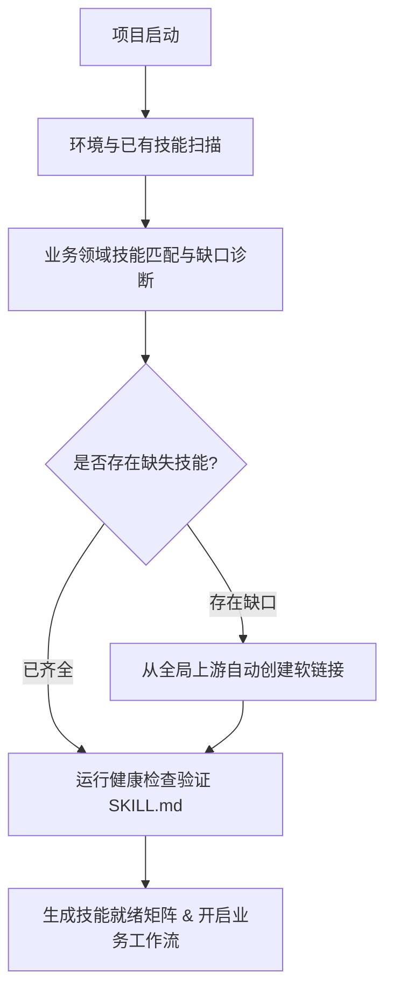

# 项目初始化与技能自动补全指南 (Project Skill Initialization Guide)

> 面向 Antigravity、OpenAI Codex、Claude Code 的全环境 Agent 技能初始化、检测与补全规范。

---

## 1. 核心架构与技能层级

在多智能体开发环境中，技能遵循两级分层架构：

```
全局层 (Global SSOT)
├── ~/.gemini/marketing-skills-upstream/        # 原始 GitHub 上游仓库 (128 个营销技能源码)
├── ~/.gemini/config/skills/                    # Google Antigravity 全局技能软链接
├── ~/.codex/skills/                            # OpenAI Codex 全局技能软链接
├── ~/.claude/skills/                           # Claude Code 全局技能软链接
├── ~/.agents/skills/                           # 通用 Agent 标准全局技能库
└── ~/.cc-switch/skills/                        # CC-Switch 集中调度存储 (+ cc-switch.db 注册表)

项目工作区层 (Workspace Local)
└── <project-root>/
    ├── .agents/skills/                         # 项目私有/专用技能目录 (按需链接或独立存放)
    └── AGENTS.md / GEMINI.md                   # Agent 项目协议与自动检测指令
```

---

## 2. 新旧项目技能生命周期

无论是新项目立项还是旧项目重构，技能生命周期分为 4 个标准阶段：



1. **扫描 (Scan)**：Agent 自动探测宿主环境路径，列出当前已挂载的所有技能。
2. **诊断 (Diagnose)**：根据项目类型（如 2027 营销战略、社媒报告自动化、SaaS 推广等），比对官方 128 项营销技能清单，标记缺失项。
3. **补齐 (Install/Link)**：一键执行全局同步，或将所需技能定向软链接到项目 `.agents/skills/` 或全局环境中。
4. **校验 (Validate)**：检查 `SKILL.md` 元数据完整性，确保 Agent 可正确解析。

---

## 3. 常见业务场景推荐技能清单 (Skills Pack)

| 业务场景 | 核心必选技能 (Core Skills) | 辅助增强技能 (Supplementary) |
| :--- | :--- | :--- |
| **客户综合营销战略 (2027 Strategy)** | `product-marketing`, `marketing-plan`, `competitor-analysis`, `icp-builder`, `growth-strategy` | `positioning`, `customer-research`, `marketing-council`, `marketing-psychology`, `pricing` |
| **内容营销与社媒运营 (Content & Social)** | `content-strategy`, `content-calendar`, `social-content`, `content-repurposing`, `write-blog` | `linkedin-content`, `thread-writer`, `newsletter`, `bluesky`, `content-gap-analysis` |
| **流量获取与付费广告 (Paid Ads & SEO)** | `ads`, `ad-creative`, `google-ads`, `facebook-ads`, `linkedin-ads`, `seo-audit`, `keyword-research` | `programmatic-seo`, `serp-analyzer`, `ahrefs-research`, `semrush-research`, `cro` |
| **产品发布与获客转化 (Launch & CRO)** | `launch`, `launch-strategy`, `cro`, `page-cro`, `write-landing`, `offers`, `lead-magnets` | `signup`, `onboarding`, `paywalls`, `email-sequence`, `ab-testing` |
| **数据分析与留存运营 (Analytics & Retention)** | `analytics`, `attribution`, `google-analytics`, `churn-prevention`, `referrals` | `google-ads-report`, `similarweb-traffic`, `brand-monitor`, `marketing-loops` |

---

## 4. 冲突消解规则 (Conflict Resolution)

当 Corey Haines (`marketingskills`) 与 OpenClaudia (`openclaudia-skills`) 存在重名技能时：
- **Corey Haines 保持规范名称**：如 `copywriting`, `product-marketing`, `content-strategy`, `seo-audit`, `programmatic-seo`, `copy-editing`, `marketing-ideas`。
- **OpenClaudia 赋予 `oc-` 前缀**：如 `oc-copywriting`, `oc-product-marketing` 等。
- 两者共存，互不覆盖，Agent 可按需选用。

---

## 5. 一键管理命令参考

```bash
# 全局健康校验
bash ~/.gemini/marketing-skills-upstream/marketing-skills-manage.sh validate

# 查看所有全局环境已激活数量
bash ~/.gemini/marketing-skills-upstream/marketing-skills-manage.sh active

# 从 GitHub 上游更新并重新全环境同步
bash ~/.gemini/marketing-skills-upstream/marketing-skills-manage.sh update
```
